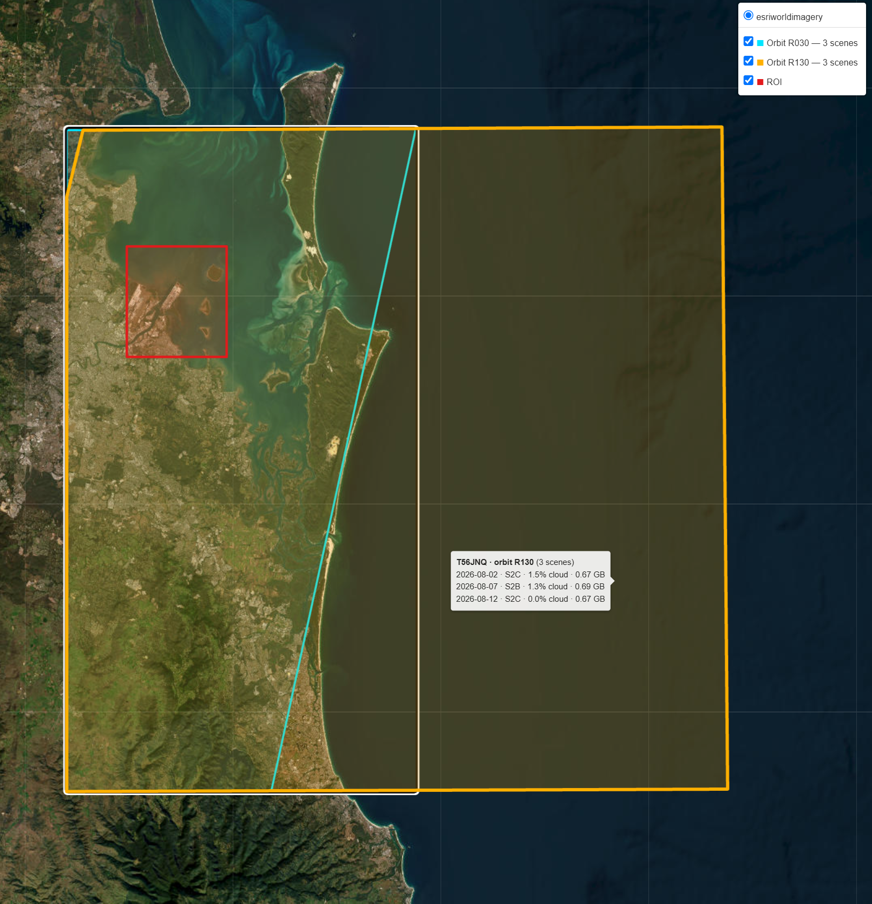

# 🧑‍💻 cdse-sentinel2-pipeline

[](https://doi.org/10.5281/zenodo.23598342)

<table align="right">
  <tr>
    <td align="center">
      <a href="https://www.esa.int/Applications/Observing_the_Earth/Copernicus/Sentinel-2" target="_blank">
        
      </a>
      <br>
      <b>👤 Julian Manning</b>
      <br>
      <sub>♻️ Last updated: <b>October 2026</b></sub>
      <br>
      <sub>📝 <b>Sentinel-2 Download Workflow</b></sub>
      <br>
      <sub>📧 <a href="mailto:julian.manning@outlook.com">julian.manning@outlook.com</a></sub>
      <br>
      <sub>🔗 Connect on <a href="https://www.linkedin.com/in/julian-manning/">LinkedIn</a></sub>
    </td>
  </tr>
</table>


A high-throughput, multithreaded Python pipeline for querying and downloading Sentinel-2 imagery from the modern Copernicus Data Space Ecosystem (CDSE). It features dynamic ROI overlap reduction to discard redundant edge-tiles, a selection preview with footprint map and volume estimate, resumable downloads, a fully automated Conda/Jupyter environment setup, and batch extraction to analysis-ready `.SAFE` directories.


<br clear="right">

---

## 🛰️ The Problem: A Broken Ecosystem

If you work with satellite imagery, you likely know the bad news: the legacy **Copernicus Open Access Hub (SciHub) has been officially retired.** Almost overnight, hundreds of automated Python scripts and GIS pipelines broke, leaving developers scrambling to adapt to the new Copernicus Data Space Ecosystem (CDSE).

While the standard CDSE web portal is fine for downloading a few single scenes, teams tackling **complex study areas, large geographic boundaries, or extensive time-series datasets** need an automated, programmatic pipeline.

### Why not just use Cloud platforms (GEE, Planetary Computer)?
While cloud-native ecosystems have made basic Earth Observation analysis accessible, scaling professional pipelines on public cloud infrastructure routinely hits three brick walls:
1. **Incomplete Processing Levels:** Many cloud repositories only host specific downstream products (e.g., Microsoft Planetary Computer exclusively hosts L2A). If your workflow requires raw Level-1C (Top-of-Atmosphere) imagery — for example for your own atmospheric correction with ACOLITE or Sen2Cor — you are locked out.
2. **The Commercial Paywall:** Tools like Google Earth Engine (GEE) are phenomenal for non-commercial research, but moving those identical workflows into an enterprise environment requires paid Google Cloud accounts with strict billing models tied to compute and storage consumption.
3. **Severe Quotas:** Processing extensive spatial boundaries on free cloud tiers routinely triggers server-side memory timeouts, strict API rate limits, and massive export queuing delays.

For uninhibited access to raw, native satellite archives without the overhead or restrictions, a highly optimised local downloader is a requirement.

---

## ⚡ Core Features

Instead of building a convoluted "black-box" Python package, this repository is designed as a highly transparent **Clone-and-Run Toolkit** utilising a sequential Jupyter Notebook workflow.

* **CDSE Native & OData Powered**: Built from scratch for the new infrastructure using modern OData catalogue querying and Keycloak OAuth2 authentication, with **automatic pagination** so long time ranges and large ROIs are never silently truncated at 1,000 products, and **inclusive** date windows.
* **Cloud & Processing-Level Filtering**: Restrict by maximum cloud cover and processing level (`L1C`, `L2A`), and keep only the newest processing baseline (`Nxxxx`) of any reprocessed tile.
* **Smart Spatial Thresholding (Anti-Redundancy Filter)**: Standard scripts blindly download massive 1GB+ tiles if they touch your Region of Interest (ROI) by even 1%. This pipeline dynamically reprojects your spatial boundary to a local UTM coordinate system, computes the true geometric intersection area, and **drops redundant edge-tiles**. Tiles from the same overpass are combined greedily — largest overlap first, keeping a tile only if it adds new ROI area — so the pipeline selects the **minimal tile set** that covers your ROI, whether it sits inside one tile or spans many, and drops overpasses below your coverage threshold (e.g., `< 70%`). Save massive amounts of disk space and hours of bandwidth.
* **Preview Before You Pull**: A dry-run cell prints a per-tile coverage audit and a product table (date, platform, level, MGRS tile, baseline, cloud %, ROI coverage, size) with the **total download volume**, and maps every selected footprint against your ROI on Esri satellite imagery.
* **High-Throughput, Resumable Parallel Execution**: Concurrent downloads via a multi-worker `ThreadPoolExecutor`, automatic Keycloak token refresh, atomic `.part` writes with byte-size verification, skipping of files already on disk, and a CSV log written as each tile completes — interrupted runs resume exactly where they stopped.
* **Turnkey Deployment (Zero Environment Friction)**: Avoid the classic "GDAL installation nightmare." The pipeline includes an automated, asynchronous environment builder that handles version-pinned Conda synchronisation and registers a system-level Jupyter kernel automatically.
* **Automated Batch Extraction**: Automatically unpacks downloaded `.zip` archives into the strict `.SAFE` directory layouts mandated by native geospatial workflows.

---

## 🗺️ Example Output

Footprint preview from `p01_s2_download_pipeline.ipynb` — six Sentinel-2 L1C acquisitions of tile T56JNQ (1–15 Aug 2026) over a Port of Brisbane ROI (red). Footprints are merged per relative orbit: R130 (amber) covers the full tile, R030 (cyan) only its western edge.



> 📌 **Interactive maps on GitHub**: The notebooks' Folium maps are HTML/JavaScript outputs, which GitHub's notebook preview does not execute — it displays *"Make this Notebook Trusted to load map"* instead. This is a GitHub rendering limitation, not an error: the maps are fully interactive when the notebooks are run locally in Jupyter, and can be exported to standalone `.html` files via the `save_path` argument.

---

## 📂 Repository Structure

```text
cdse-sentinel2-pipeline/
│
├── p00_s2_download_env_setup.ipynb   # Step 0: Turnkey workspace & kernel initialisation
├── p01_s2_download_pipeline.ipynb    # Step 1: Spatial query, overlap filtering, preview & threaded download
├── p02_s2_download_unzip.ipynb       # Step 2: Automated extraction to structured .SAFE directories
│
├── DATA/                             # Local data vault (downloads ignored by git)
│   ├── SHP/                          # Your study-area ROI shapefiles (committed)
│   └── S2/<year>/                    # Downloaded .zip archives + CSV download log
│       └── UNZIP/                    # Target directory for unzipped .SAFE archives
│
├── Tools/                            # Core pipeline backend orchestration engines
│   ├── env.base.yml                  # Loose environment specs for development
│   ├── env.lock.yml                  # Fully version-pinned production lockfile
│   ├── s2_download_env_builder.py    # Conda & Jupyter lifecycle automation script
│   └── s2_download_helper_utility.py # Spatial parsing, API calling, preview and multithreading engines
│
└── Example/                          # Sample geospatial inputs & outputs for out-of-the-box evaluation
    ├── SHP/                          # Target Region of Interest (ROI) vector layers
    └── IMG/                          # Static map previews used in this README
```

## 🚀 Execution Workflow

### Step 0: Workspace Initialisation
Open and execute `p00_s2_download_env_setup.ipynb`. The automated runtime manager will:

* Scan for the dedicated `sentinel2` Conda environment.

* Synchronise dependency deltas securely from the version lockfile.

* Link the backend kernel path and register it cleanly into your Jupyter notebook system.

### Step 1: Data Acquisition, Preview & Download
Open `p01_s2_download_pipeline.ipynb` and select your newly minted `Python 3 (sentinel2)` kernel.

* Input your study area vector dataset path (any CRS — it is reprojected to EPSG:4326 automatically).

* Define the temporal range (both dates inclusive), processing level and maximum cloud cover.

* Configure `min_roi_coverage_frac` — the fraction of your ROI the selected tiles of an overpass must cover (e.g., `0.70`). For ROIs wider than one overpass swath (~290 km) use a low value such as `0.10`. Set `coverage_mode="best_tile"` to restore the original single-best-tile behaviour.

* Run the **preview cell** to inspect the coverage audit, product table, total volume and footprint map.

* Run the pipeline to authenticate with CDSE Keycloak and stream parallelised downloads. If interrupted, run the **resume cell** to fetch only what is missing.

### Step 2: Extraction (unzip)
Open `p02_s2_download_unzip.ipynb`. Run the batch extractor to expand downloaded archives into the standard `.SAFE` layout used by native geospatial pipelines.

---

## 📋 Requirements
* Active user credentials on the Copernicus Data Space Ecosystem.
* An existing installation of Miniconda / Anaconda.
* Python: Version 3.11 was used for the asynchronous environment manager.
* Dependencies: All secondary libraries are managed via the included `Tools/env.lock.yml` file.
* Storage: Sentinel-2 L1C/L2A tiles are typically ~0.4–1.2 GB each. Use the preview cell's volume estimate before large queries.

## 🔗 Related
* **[cdse-sentinel1-pipeline](https://github.com/julianManning/cdse-sentinel1-pipeline)** ([DOI: 10.5281/zenodo.23595216](https://doi.org/10.5281/zenodo.23595216)) — the companion workflow for Sentinel-1 SAR (GRD/SLC) products.

## 📚 Citation & Data Attribution
* **Citing this software**: use **"Cite this repository"** in the GitHub sidebar (generated from `CITATION.cff`), or cite the Zenodo archive: **[doi:10.5281/zenodo.23598342](https://doi.org/10.5281/zenodo.23598342)**.
* **Copernicus data**: products derived from data downloaded with this pipeline should carry the notice *"Contains modified Copernicus Sentinel data [year]"*, as required by the Copernicus Sentinel data licence.

## 🛡️ License
This project is open-source and available under the **[MIT License](https://opensource.org/licenses/MIT)**. You are free to use, modify, and distribute this software for personal, academic, or commercial projects.
